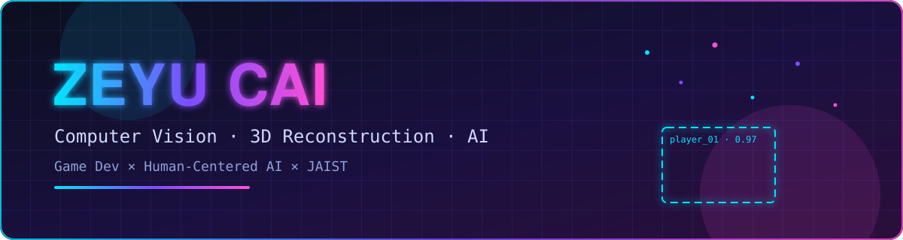

<div align="center">

[)](https://github.com/itsmccai)


[](https://www.youtube.com/@xi5016)
[](https://space.bilibili.com/451051903)
[](https://www.linkedin.com/in/zeyu-cai-0a1675292)
[](mailto:singalcai@gmail.com)

</div>

---

## ⚡ About

Master's student at **JAIST** (Xie Haoran Laboratory, Human-Centered AI) working on **computer vision and 3D reconstruction**. B.S. in Computer Science from Temple University, Japan Campus.
I turn ideas into working prototypes — from sports-video tracking and 3D Gaussian Splatting to Unity games and Kotlin + Firebase apps.

```text
> whoami
zeyu_cai  →  CV / 3D / AI engineer  ×  game developer
> languages
中文 (native)  ·  English (advanced)  ·  日本語 (JLPT N2)
```

---

## 🔬 Computer Vision & AI

| Project | What it does | Stack |
|---|---|---|
| 🏀 **Sports Video Tracking** | Segmentation and real-time tracking on NBA game footage | SAM2 |
| 🌐 **3D Gaussian Splatting Pipelines** | 3D reconstruction and vision pipelines, pose / landmark tracking | 3DGS · COLMAP · gsplat · gsplat.js · MediaPipe |
| 🤖 **Inquiry → Quotation Automation** | LLM / RAG workflow with human review for repeatable quotation tasks | n8n · RAG · Google Sheets |

## 🕹 Game Development
- Unity 3D cooking game — cooking controller, recipe logic, UI, tutorial highlighting
- C++ / SFML ECS platformer (Temple CIS-3100)
- Gameplay systems, UI logic, scene architecture

## 📱 Mobile & Web
- Campus social app — Kotlin + Firebase (Auth, Firestore, Storage), MVVM, real-time interaction
- Frontend prototyping, FastAPI / REST APIs, Vue 3

---

## 🧰 Tech Stack

<p align="center">
  
</p>

---

## 🐱 Featured Project — TravelMeow

An interactive web app I built as a personal gift, where users feed a virtual cat while exploring a cute travel-themed interface.

✨ Creativity, emotion, and frontend interaction  
🎮 Mini-game style web experience  
💗 Designed as a surprise project

🔗 **Live Demo:** https://itsmccai.github.io/TravelMeow/

## 🎥 Featured Videos

| Platform | Preview |
|----------|---------|
| YouTube | [](https://www.youtube.com/watch?v=78fIew5jJjc) |
| YouTube | [](https://www.youtube.com/watch?v=jln4MhcEZ7o) |
| Bilibili | [Unity 2D Cooking Game ▶](https://www.bilibili.com/video/BV1EU4y1s7x6) |

---

## 📊 GitHub Activity

<p align="center">
  
  
</p>
<p align="center">
  
</p>


